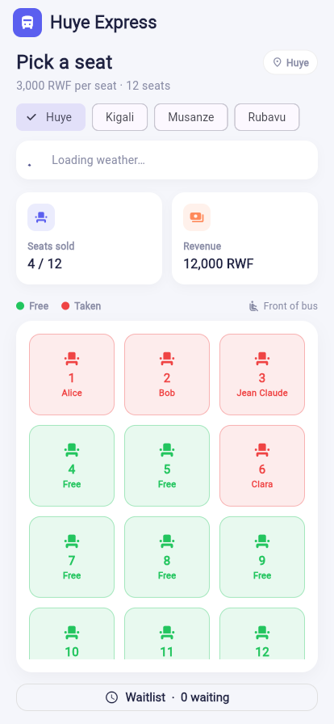
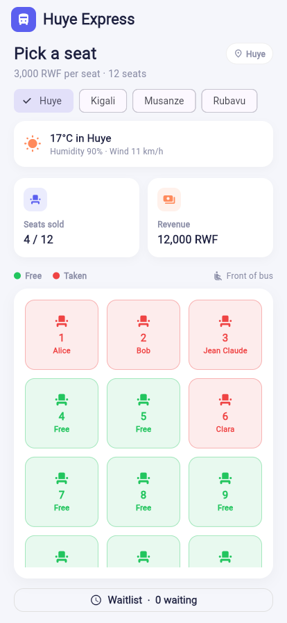
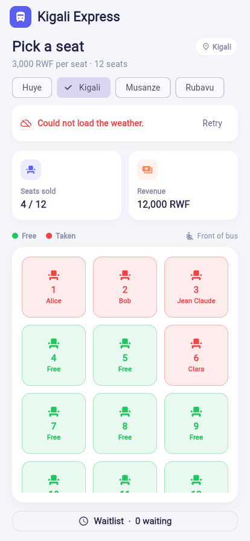

# Bus Booking App

A Flutter app for booking seats on a bus. My data is now saved on the phone with shared_preferences, so nothing is lost when the app closes, and it shows live weather for the selected destination from the Open-Meteo API.

## Screenshots

